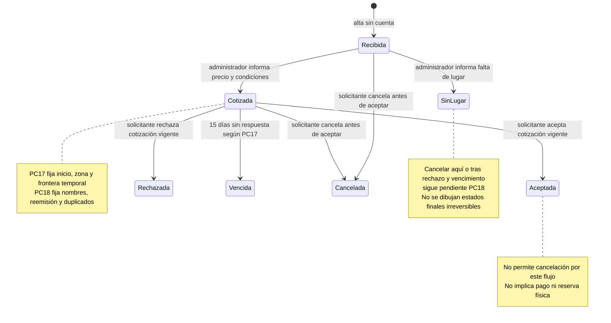

Implementación vigente autorizada RF25–31: [ADR010](adr/010.md). Máquina técnica provisional REGISTRADA → COTIZADA/SIN_LUGAR; COTIZADA → ACEPTADA/RECHAZADA/VENCIDA; cualquier estado no aceptado/no cancelado → CANCELADA. Sin reapertura/recotización. Frontera técnica UTC emisión +360h, inclusiva para vencer; reloj tras bloqueo, consulta/comando hace efectivo vencimiento aun si responde 409. PC17/18 siguen abiertas; no se presenta la máquina como decisión definitiva del cliente. El diagrama y las restricciones de diseño siguientes son antecedentes conservados, sustituidos para este alcance autorizado.

> Vista histórica conservada de revisión 01/02. Para estado vigente consultar decisiones-pc-revision03.md, consultas-docente-revision03.md, referencia-iglesias-revision03.md y trazabilidad-revision03.md. Las afirmaciones anteriores de ausencia total de producto/23 preguntas docentes no describen revisión 03.

# Estados preliminares de solicitudes de espacio

Basado en RF-26 a RF-31, RN-17 a RN-21 y P088–P090. Los nombres son vocabulario de diseño, no estados confirmados por el docente. PC-17 y PC-18 permanecen abiertas. Solicitud y cotización se distinguen para no confundir «venció el precio» con «se eliminó la solicitud».

El diagrama muestra las transiciones directamente respaldadas y dos cancelaciones de casos inequívocamente anteriores a la aceptación. No limita la frase «mientras no la acepte» a esos dos estados: cancelar tras rechazo, vencimiento o falta de lugar queda expresamente sin resolver, no prohibido. No se implementará una máquina cerrada con esta omisión.

## Matriz de transición para revisar

| Origen | Evento y actor | Guarda | Resultado propuesto | Base o bloqueo |
| --- | --- | --- | --- | --- |
| Sin solicitud | Alta, visitante | Oferta pertenece a iglesia; contacto validado según PC-14 | Recibida, folio y clave | RF-26 |
| Recibida | Emitir/comunicar precio, administrador propio | Disponibilidad declarada por administrador; importe y condiciones; PC-16/17 resueltas | Cotizada; cotización Pendiente | RF-28, sin inventario obligatorio |
| Recibida | Informar falta de lugar, administrador propio | Autorización y versión actual | SinLugar | RF-28; no decide reapertura |
| Cotizada | Aceptar, solicitante con credenciales | Cotización actual, pendiente, vigente; control de versión y vencimiento | Aceptada; cotización Aceptada | RF-29; frontera PC-17 |
| Cotizada | Rechazar, solicitante con credenciales | Misma guarda temporal | Rechazada; cotización Rechazada | RF-29; reapertura PC-18 |
| Cotizada | Vencer, sistema | Sin respuesta y reloj alcanza frontera acordada | Vencida; cotización Vencida | RF-30; no depende solo de cron |
| Recibida o Cotizada | Cancelar, solicitante | No aceptada, credenciales y versión | Cancelada; pendiente queda inhabilitada para responder | RF-31; rótulo de cotización cancelada propuesto |
| SinLugar, Rechazada o Vencida | Cancelar, solicitante | No aceptada, pero comportamiento exacto no resuelto | Por confirmar | PC-18; no convertir en denegación definitiva |
| Aceptada | Cancelar, solicitante | Guarda de negocio falla | Rechazo de operación; conserva estado | RN-21 explícita |
| Rechazada, Vencida o SinLugar | Reabrir o recotizar, administrador | Sin regla confirmada | Por confirmar | PC-17/18; no añadir ruta activa |
| Cualquier estado | Respuesta duplicada o simultánea | Comparación de versión, identidad y estado actual | Conflicto técnico previsto; idempotencia exacta por acordar | PC-18 |

## Tiempo, privacidad y concurrencia

Se conservarán emisión, comunicación y vencimiento como instantes separados. No se elige silenciosamente emisión + 360 horas ni fin del decimoquinto día local: son alternativas de PC-17. La cotización no se podrá emitir en el sistema final hasta disponer de una política resuelta. La API expondrá `venceAt` calculado por el servidor, no una fecha arbitraria enviada por el administrador.

El seguimiento usa folio y clave; el folio no autentica por sí solo. La clave nunca viaja en URL ni logs y se almacena con hash. La transacción relee estado y vencimiento bajo bloqueo o versión antes de mutar. En una carrera aceptación/vencimiento no pueden persistirse ambos resultados; cuál gana exactamente en la frontera se define con PC-17. Aplicar vencimiento en lectura y comando evita aceptar por retraso de un trabajo periódico.

El evento registra actor (administrador, solicitante o sistema), instante y transición; no copia contactos ni credenciales innecesariamente. Campos visibles al solicitante y a cada rol se validan con PC-15/19.

## Pruebas previstas, no ejecutadas

Alta sin cuenta, credenciales incorrectas, acceso cruzado de iglesia, cotización vigente, vencimiento sin respuesta, rechazo, cancelación antes de aceptar y prohibición después; tres puntos alrededor de la frontera acordada; respuesta duplicada, dos aceptaciones concurrentes y aceptación contra cancelación/vencimiento. Los casos pendientes se convierten en pruebas al recibir las respuestas; no se marcan en verde por existir este documento.
