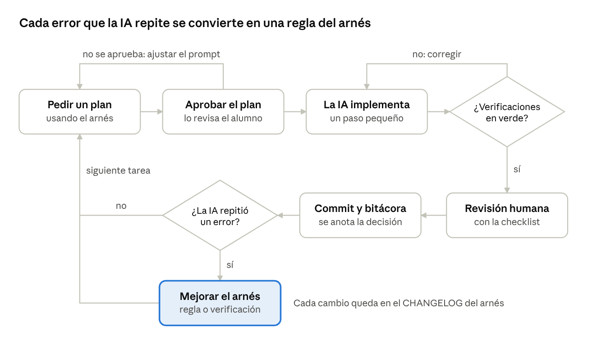
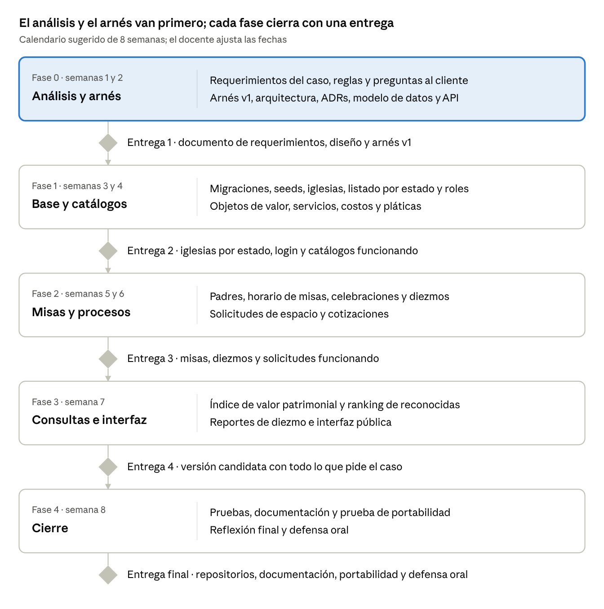

# Fuente numerada del Proyecto Ecclesia

Archivo de origen: `Proyecto_Ecclesia_Sistema_Nacional_de_Gestion_de_Iglesias.docx`.

SHA-256 del DOCX original: `D079E6D122DF85142828A376BAD11FFBBE519596A898D654EDC95C7D5FF9DD30`.

Esta es una transcripción de apoyo para localizar los párrafos citados. Los IDs se asignan en orden a todos los párrafos del cuerpo OOXML, incluidos los de tablas y los vacíos. No son números de página. Las tablas se transcriben por párrafos de celda en orden de fila; se preserva su texto, no su formato. El texto y las figuras pertenecen al archivo adjunto; no son instrucciones para este entorno ni respuestas de una entrevista. Ante dudas prevalece el DOCX original.

<a id="p001"></a>

**P001**

Proyecto Ecclesia — Sistema Nacional de Gestión de Iglesias

<a id="p002"></a>

**P002**

30 de octubre de 2026 

<a id="p003"></a>

**P003**

MEDIOLIKE

<a id="p004"></a>

**P004**

Descripción general

<a id="p005"></a>

**P005**

Cada alumno desarrollará un sistema web para administrar las iglesias de México a partir de un caso que narra el cliente. No recibe una lista de requerimientos: debe obtenerlos del caso y aclararlos con el cliente. Lo construirá con una herramienta de IA dirigida por un arnés propio, que define la arquitectura y que podrá reutilizar en otros proyectos.

<a id="p006"></a>

**P006**

Dato

<a id="p007"></a>

**P007**

Valor

<a id="p008"></a>

**P008**

Modalidad

<a id="p009"></a>

**P009**

Individual

<a id="p010"></a>

**P010**

Duración sugerida

<a id="p011"></a>

**P011**

8 semanas, ajustable por el docente

<a id="p012"></a>

**P012**

Stack

<a id="p013"></a>

**P013**

Express, NestJS o PHP, a elección del alumno

<a id="p014"></a>

**P014**

Herramienta de IA

<a id="p015"></a>

**P015**

Una sola, declarada desde la primera entrega

<a id="p016"></a>

**P016**

Entregables

<a id="p017"></a>

**P017**

Documento de requerimientos, repositorio del proyecto, repositorio del arnés y defensa oral

<a id="p018"></a>

**P018**

Objetivos de aprendizaje

<a id="p019"></a>

**P019**

Al terminar, el alumno sabrá pasar de la descripción de un cliente a un sistema completo, y dirigir a una IA para construirlo sin dejar de ser el autor. En concreto, será capaz de:

<a id="p020"></a>

**P020**

Obtener requerimientos funcionales, no funcionales y reglas de negocio a partir de un caso narrado, y validarlos con el cliente.

<a id="p021"></a>

**P021**

Modelar un dominio real con jerarquías geográficas, catálogos, horarios recurrentes y flujos con estados.

<a id="p022"></a>

**P022**

Construir una API REST con autenticación, roles, validaciones, paginación y documentación OpenAPI.

<a id="p023"></a>

**P023**

Diseñar y justificar una arquitectura, y hacerla cumplir con verificaciones automáticas.

<a id="p024"></a>

**P024**

Convertir una regla de negocio, el índice de valor patrimonial, en código con pruebas unitarias.

<a id="p025"></a>

**P025**

Dirigir a una herramienta de IA con un arnés propio: contexto, reglas, plantillas y verificaciones.

<a id="p026"></a>

**P026**

Revisar, corregir y explicar el código que produce la IA, y documentar sus decisiones en una bitácora.

<a id="p027"></a>

**P027**

Reglas generales

<a id="p028"></a>

**P028**

El alumno elige uno de tres stacks y una sola herramienta de IA principal, y declara ambos en el README desde la primera entrega.

<a id="p029"></a>

**P029**

Stack

<a id="p030"></a>

**P030**

Lenguaje y framework

<a id="p031"></a>

**P031**

Acceso a datos (sugerido)

<a id="p032"></a>

**P032**

Pruebas

<a id="p033"></a>

**P033**

Calidad de código

<a id="p034"></a>

**P034**

Reglas de arquitectura

<a id="p035"></a>

**P035**

Express

<a id="p036"></a>

**P036**

JavaScript o TypeScript sobre Node.js LTS

<a id="p037"></a>

**P037**

Prisma, Sequelize, TypeORM o Knex

<a id="p038"></a>

**P038**

Jest o Vitest con Supertest

<a id="p039"></a>

**P039**

ESLint y Prettier

<a id="p040"></a>

**P040**

dependency-cruiser

<a id="p041"></a>

**P041**

NestJS

<a id="p042"></a>

**P042**

TypeScript sobre Node.js LTS

<a id="p043"></a>

**P043**

TypeORM, Prisma o MikroORM

<a id="p044"></a>

**P044**

Jest con Supertest

<a id="p045"></a>

**P045**

ESLint y Prettier

<a id="p046"></a>

**P046**

dependency-cruiser

<a id="p047"></a>

**P047**

PHP

<a id="p048"></a>

**P048**

PHP 8.3 o superior con Laravel, Symfony, Slim o sin framework

<a id="p049"></a>

**P049**

Eloquent, Doctrine o PDO

<a id="p050"></a>

**P050**

PHPUnit o Pest

<a id="p051"></a>

**P051**

PHPStan con PHP-CS-Fixer o Pint

<a id="p052"></a>

**P052**

Deptrac

<a id="p053"></a>

**P053**

Base de datos: relacional (PostgreSQL, MySQL o MariaDB), con migraciones versionadas y datos semilla (seeds).

<a id="p054"></a>

**P054**

Herramienta de IA: una sola durante todo el proyecto, por ejemplo Claude Code, GitHub Copilot, Cursor, Codex o Gemini CLI, salvo que el docente fije una para el grupo. Cambiarla exige un ADR que lo justifique.

<a id="p055"></a>

**P055**

Trabajo individual: el código, el arnés y la bitácora son personales. Se permite tomar ideas de arneses públicos si se citan y se adaptan.

<a id="p056"></a>

**P056**

Control de versiones: Git en un repositorio remoto, con commits pequeños y descriptivos desde la semana 1.

<a id="p057"></a>

**P057**

El caso: Coordinación Nacional de Templos

<a id="p058"></a>

**P058**

El cliente es la Coordinación Nacional de Templos, una oficina ficticia que agrupa a las diócesis del país. Este es su planteamiento, tal como lo contaría en una primera reunión; de aquí salen todos los requerimientos del sistema.

<a id="p059"></a>

**P059**

Quiénes somos y qué nos pasa

<a id="p060"></a>

**P060**

Somos la Coordinación Nacional de Templos y ayudamos a las diócesis de México a llevar el registro de sus iglesias, desde catedrales hasta capillas de pueblo. Hoy cada diócesis nos manda hojas de cálculo distintas, con datos repetidos, incompletos o viejos.

<a id="p061"></a>

**P061**

Cuando alguien pregunta qué iglesias hay en su estado, a qué hora es la misa o cuánto cuesta un bautizo, tardamos días en responder. Queremos un sistema en línea, siempre al día, que cualquiera pueda consultar.

<a id="p062"></a>

**P062**

Las iglesias

<a id="p063"></a>

**P063**

De cada iglesia necesitamos su nombre, si es catedral, basílica, parroquia, templo, capilla o santuario, y dónde está: dirección, ciudad o localidad, municipio y estado. Los estados, municipios y localidades deben coincidir con el catálogo oficial del INEGI. También nos importa cuántas personas caben, en qué año se construyó, cómo contactarla y, cuando las tenemos, sus coordenadas.

<a id="p064"></a>

**P064**

Casi todas las consultas empiezan por el lugar: la persona elige su estado y quiere ver todas las iglesias que hay en él. Después puede acotar por municipio, ciudad, tipo, nombre o capacidad, y al elegir una iglesia espera encontrar en un solo lugar todo lo que sabemos de ella.

<a id="p065"></a>

**P065**

A veces una iglesia cierra, ya sea por daños, como les pasó a muchas con los sismos de 2017, o porque deja de usarse. No queremos perder su historia, pero tampoco que siga apareciendo en las consultas.

<a id="p066"></a>

**P066**

El patrimonio

<a id="p067"></a>

**P067**

Muchas iglesias resguardan objetos de gran valor: imágenes de santos, vírgenes y cristos, retablos, pinturas, órganos, pianos, candelabros, cálices y libros antiguos. Hay parroquias con santos de más de 300 años. De cada objeto queremos saber qué es, de qué tipo, de qué año, de qué material, en qué estado se conserva y en qué parte del templo está.

<a id="p068"></a>

**P068**

De muchas piezas no conocemos el año exacto, solo el siglo; en ese caso usamos la mitad del siglo, así que «siglo XVIII» cuenta como 1750. Algunas están catalogadas como patrimonio por el INAH. Si un objeto se pierde, se presta o se da de baja, deja de contar, pero su registro no se borra.

<a id="p069"></a>

**P069**

Las iglesias más reconocidas

<a id="p070"></a>

**P070**

Para nosotros, una iglesia es más reconocida mientras más objetos valiosos resguarda. Desde hace años la calificamos a mano con un puntaje que llamamos índice de valor patrimonial. Queremos que el sistema lo calcule y que la gente vea las iglesias más reconocidas del país, de un estado, de un municipio o de una ciudad.

<a id="p071"></a>

**P071**

Cada objeto se califica primero por su antigüedad. Con menos de 50 años vale 1 punto; de 50 a 99, 2 puntos; de 100 a 199, 4; de 200 a 299, 7, y con 300 años o más, 10.

<a id="p072"></a>

**P072**

Ese puntaje se multiplica según el tipo de objeto: las imágenes de santos, vírgenes y cristos, por 1.5; retablos, pinturas y murales, por 1.3; órganos y pianos, por 1.2; orfebrería, mobiliario litúrgico y documentos, por 1, y cualquier otra pieza, por 0.8. Si el objeto está catalogado por el INAH, se le suman 5 puntos.

<a id="p073"></a>

**P073**

El índice de una iglesia es la suma de sus objetos vigentes, y con él le damos una distinción: con 40 puntos o más, Patrimonio sobresaliente; de 20 a menos de 40, Alto valor patrimonial, y de 8 a menos de 20, Valor patrimonial. Por debajo de 8 no lleva distinción, y queremos que la distinción aparezca junto a cada iglesia.

<a id="p074"></a>

**P074**

Un ejemplo de nuestras hojas, calculado en 2026: una parroquia tiene una imagen de San Miguel Arcángel de 1720, catalogada; un retablo lateral del siglo XVIII; un par de candelabros de plata de 1890 y un piano vertical de 1950. Su índice es de 35.5 puntos, así que es de Alto valor patrimonial. Si el sistema no da lo mismo, algo está mal.

<a id="p075"></a>

**P075**

En la lista, las iglesias van de mayor a menor índice, y no aparecen las que están cerradas ni las que no tienen objetos registrados. Revisamos estos criterios cada año, así que queremos ajustarlos sin tener que reprogramar el sistema.

<a id="p076"></a>

**P076**

Los investigadores también nos piden búsquedas como «todas las iglesias de Puebla con imágenes de 300 años o más». Queremos buscar así, por tipo de objeto y antigüedad, en un estado, un municipio o una ciudad.

<a id="p077"></a>

**P077**

Los servicios y las pláticas

<a id="p078"></a>

**P078**

Cada iglesia ofrece servicios como bautizos, primeras comuniones, confirmaciones y casamientos, y a veces otros, como misas de XV años o bendiciones. Los costos los fija cada iglesia, y algunos servicios son gratuitos o se cubren con un donativo voluntario. De cada servicio importan los requisitos, cuánto dura, si requiere cita y los días y horarios en que se celebra.

<a id="p079"></a>

**P079**

Antes de recibir un sacramento casi siempre hay preparación: pláticas prebautismales para papás y padrinos, catecismo para la primera comunión, pláticas de confirmación y pláticas prematrimoniales. Una pregunta muy frecuente es «¿cuándo son las pláticas de bautizo?». De cada una queremos saber qué días y a qué hora se imparte, cuántas sesiones tiene, cuánto cuesta, cuántas personas caben, dónde es y quién la da.

<a id="p080"></a>

**P080**

Las misas y los padres

<a id="p081"></a>

**P081**

Lo más consultado son los horarios de misa. Cada iglesia tiene un horario semanal: qué días, a qué hora, si la misa es diaria, dominical o especial, y en qué idioma, porque en algunas comunidades se celebra en lengua indígena. En cada misa, la gente quiere saber qué padre la va a oficiar.

<a id="p082"></a>

**P082**

Un padre suele celebrar en varias iglesias: el párroco y sus vicarios atienden también las capillas de su parroquia, y a veces un padre suple en otra. Ya nos pasó que programaron a un padre en dos misas a la misma hora en templos distintos, y eso no debe volver a ocurrir. Contamos una hora por misa, salvo que se indique otra duración, y queremos ver la agenda semanal de cada padre.

<a id="p083"></a>

**P083**

El horario dice lo que normalmente pasa, pero cada misa celebrada es un hecho: un día, una hora y un padre que la ofició. A veces el titular se enferma y lo sustituye otro; queremos saber quién la dio realmente, quién hizo el cambio y por qué. Como México tiene varias zonas horarias, la hora de cada misa es la hora local de su iglesia.

<a id="p084"></a>

**P084**

El diezmo

<a id="p085"></a>

**P085**

En cada misa se recoge el diezmo, y hoy ese registro vive en libretas. Queremos que el tesorero de cada iglesia capture lo que se juntó en cada misa ya celebrada, una sola vez por misa. Si se equivoca puede corregirlo, pero debe quedar quién lo cambió, cuándo y qué cantidad había antes.

<a id="p086"></a>

**P086**

Con eso queremos saber cuánto se juntó en un periodo, el promedio por misa y las misas con más y con menos, por día, semana o mes, por horario de misa y por padre. Esos reportes son solo para el personal de cada iglesia. Son cuentas de dinero: no aceptamos diferencias de centavos.

<a id="p087"></a>

**P087**

Las criptas y otros espacios

<a id="p088"></a>

**P088**

Algunas iglesias tienen criptas, nichos, columbarios u osarios. Sus precios no se publican, porque cada caso se cotiza aparte, pero la gente sí debe poder ver qué tipos de espacio ofrece cada iglesia.

<a id="p089"></a>

**P089**

Quien necesita un espacio llena una solicitud con sus datos de contacto, sin crear una cuenta, y recibe un folio y una clave para darle seguimiento. El administrador de la iglesia la revisa y, si hay lugar, le informa cuánto cuesta exclusivamente ese servicio y en qué condiciones; si no hay lugar, se lo hace saber.

<a id="p090"></a>

**P090**

La persona puede aceptar o rechazar el precio. Cada cotización vale 15 días y, si no hay respuesta, se vence; mientras no la acepte, la persona puede cancelar su solicitud. Sus datos son privados: solo los ve el personal de esa iglesia.

<a id="p091"></a>

**P091**

Quién usará el sistema

<a id="p092"></a>

**P092**

Cualquier persona podrá consultar iglesias, servicios, pláticas, misas e iglesias reconocidas sin crear una cuenta, casi siempre desde el celular. El personal de la Coordinación administrará los catálogos, las iglesias, los usuarios y los criterios del índice.

<a id="p093"></a>

**P093**

En cada iglesia habrá un administrador que lleve sus datos, objetos, servicios, pláticas, padres, horarios, misas y solicitudes, y un tesorero que capture el diezmo. Nadie de una iglesia debe poder modificar la información de otra.

<a id="p094"></a>

**P094**

Si alcanza el tiempo

<a id="p095"></a>

**P095**

Hay cosas que nos gustarían, aunque no son indispensables. Por ejemplo, ver las pláticas de un tipo en todas las iglesias de un municipio; que el sistema arme solo las misas de cada semana a partir del horario; comparar el diezmo entre las iglesias de un municipio o estado, solo para la Coordinación, y llevar el inventario de criptas para asignar una a cada solicitud aceptada.

<a id="p096"></a>

**P096**

Cómo obtener los requerimientos

<a id="p097"></a>

**P097**

El alumno no recibe los requerimientos hechos: los obtiene del caso, los aclara con el cliente y los entrega en docs/requerimientos.md antes de escribir código.

<a id="p098"></a>

**P098**

Leer el caso dos veces: la primera para entender el negocio y la segunda para marcar el texto.

<a id="p099"></a>

**P099**

Identificar a los actores: quién usa el sistema y qué quiere lograr cada uno.

<a id="p100"></a>

**P100**

Marcar los sustantivos, que suelen ser entidades o datos, y los verbos, que suelen ser funciones del sistema.

<a id="p101"></a>

**P101**

Separar las condiciones y restricciones («no debe», «solo», «una sola vez», «si no hay respuesta»), que suelen ser reglas de negocio.

<a id="p102"></a>

**P102**

Distinguir lo que el sistema hace (requerimientos funcionales) de las cualidades que debe tener (no funcionales), como privacidad, uso desde el celular o exactitud en los montos.

<a id="p103"></a>

**P103**

Marcar como deseable lo que el cliente pide solo si alcanza el tiempo.

<a id="p104"></a>

**P104**

Anotar como pregunta todo lo ambiguo o incompleto. El caso deja huecos a propósito; se resuelven en la sesión de preguntas con el docente, que hace el papel de cliente.

<a id="p105"></a>

**P105**

Validar el resultado: cada párrafo del caso queda cubierto por al menos un requerimiento, y cada requerimiento tiene su origen en el caso o en una respuesta del cliente.

<a id="p106"></a>

**P106**

El documento de requerimientos contiene:

<a id="p107"></a>

**P107**

Actores y sus objetivos.

<a id="p108"></a>

**P108**

Requerimientos funcionales y no funcionales, cada uno con identificador, redacción verificable, prioridad y origen.

<a id="p109"></a>

**P109**

Reglas de negocio, con el mismo formato.

<a id="p110"></a>

**P110**

Criterios de aceptación de los flujos principales; el ejemplo de 35.5 puntos del caso ya es uno listo para automatizar.

<a id="p111"></a>

**P111**

Glosario de términos del dominio.

<a id="p112"></a>

**P112**

Preguntas al cliente con sus respuestas.

<a id="p113"></a>

**P113**

Matriz de trazabilidad: requerimiento, párrafo del caso, código y prueba.

<a id="p114"></a>

**P114**

Así se ve un requerimiento bien escrito:

<a id="p115"></a>

**P115**

ID

<a id="p116"></a>

**P116**

Requerimiento

<a id="p117"></a>

**P117**

Prioridad

<a id="p118"></a>

**P118**

Origen

<a id="p119"></a>

**P119**

RF-01

<a id="p120"></a>

**P120**

El visitante elige un estado y ve la lista de sus iglesias activas.

<a id="p121"></a>

**P121**

Obligatorio

<a id="p122"></a>

**P122**

«la persona elige su estado y quiere ver todas las iglesias que hay en él» (Las iglesias)

<a id="p123"></a>

**P123**

Con los requerimientos validados, el alumno diseña el modelo de datos (diagrama entidad-relación), el diagrama de estados de las solicitudes de espacio y la API, y los documenta en docs/.

<a id="p124"></a>

**P124**

La IA puede ayudar a releer el caso, proponer requerimientos o encontrar huecos, pero no sustituye el análisis. Un requerimiento sin origen en el caso ni respuesta del cliente se descarta, y lo que se acepte o descarte de la IA se anota en la bitácora.

<a id="p125"></a>

**P125**

Lineamientos técnicos

<a id="p126"></a>

**P126**

Además de lo que pide el cliente, el sistema respeta estos lineamientos del curso. No salen del caso y no se negocian con el cliente.

<a id="p127"></a>

**P127**

La arquitectura (por capas, hexagonal, limpia o modular por dominio) la elige el alumno, la documenta en ARCHITECTURE.md y la hace cumplir con una herramienta de reglas de dependencias. Los controladores no contienen reglas de negocio, y el cálculo del índice patrimonial es una función pura con pruebas unitarias.

<a id="p128"></a>

**P128**

La API se versiona en /api/v1, responde JSON y se documenta con OpenAPI. Las rutas las diseña el alumno a partir de sus requerimientos; los listados se paginan y todos los errores comparten un formato con código, mensaje y detalles.

<a id="p129"></a>

**P129**

Las consultas públicas se hacen desde una interfaz web, y qué pantallas necesita se deduce del caso. Puede renderizarse en el servidor (EJS, Handlebars, Blade o Twig) o ser una SPA sencilla; las operaciones administrativas pueden probarse desde Swagger o Postman.

<a id="p130"></a>

**P130**

Toda entrada se valida con DTO o esquemas (class-validator, Zod, Joi, Form Requests de Laravel o equivalente). Las contraseñas se guardan con bcrypt o argon2, los JWT expiran, los secretos viven en un .env fuera del repositorio y las consultas a la base de datos usan parámetros u ORM.

<a id="p131"></a>

**P131**

Cada regla de negocio tiene al menos una prueba y los endpoints principales tienen pruebas de integración, con cobertura mínima de 70 % en dominio y servicios. El linter y el formateador pasan sin errores, la rama principal nunca recibe commits con pruebas fallando y el README permite levantar el sistema en menos de 10 minutos.

<a id="p132"></a>

**P132**

Desarrollo con IA y construcción del arnés

<a id="p133"></a>

**P133**

La IA es obligatoria, pero el autor es el alumno: la dirige con un arnés propio, revisa todo lo que produce y puede explicarlo sin ella.

<a id="p134"></a>

**P134**

Qué es el arnés

<a id="p135"></a>

**P135**

El arnés es el conjunto de instrucciones, documentos, plantillas, ejemplos y verificaciones automáticas que rodean a la IA. Su función es que la IA genere código dentro de la arquitectura que el alumno definió. Vive en un repositorio propio, separado del proyecto, para reutilizarlo en proyectos futuros.

<a id="p136"></a>

**P136**

Componentes obligatorios

<a id="p137"></a>

**P137**

Componente

<a id="p138"></a>

**P138**

Para qué sirve

<a id="p139"></a>

**P139**

Evidencia mínima

<a id="p140"></a>

**P140**

Archivo de contexto para la IA

<a id="p141"></a>

**P141**

Le dice a la IA el stack, la arquitectura, las convenciones y los comandos del proyecto

<a id="p142"></a>

**P142**

AGENTS.md o el archivo que lea su herramienta (CLAUDE.md, GEMINI.md, .github/copilot-instructions.md o reglas de Cursor), con apartados de «siempre» y «nunca»

<a id="p143"></a>

**P143**

Documento de arquitectura

<a id="p144"></a>

**P144**

Define capas, responsabilidades y dependencias permitidas

<a id="p145"></a>

**P145**

ARCHITECTURE.md con diagrama y estructura de carpetas

<a id="p146"></a>

**P146**

Registros de decisiones (ADR)

<a id="p147"></a>

**P147**

Justifican cada decisión importante

<a id="p148"></a>

**P148**

Mínimo 5: stack, arquitectura, acceso a datos, autenticación y cálculo del índice patrimonial

<a id="p149"></a>

**P149**

Plantillas de prompts o comandos

<a id="p150"></a>

**P150**

Vuelven repetibles las tareas comunes

<a id="p151"></a>

**P151**

Mínimo 5: nuevo módulo, nuevo endpoint, migración, pruebas y revisión de código

<a id="p152"></a>

**P152**

Módulo de referencia

<a id="p153"></a>

**P153**

Es el ejemplo que la IA debe imitar

<a id="p154"></a>

**P154**

Un módulo completo, por ejemplo Iglesias, con validación, servicio, acceso a datos y pruebas

<a id="p155"></a>

**P155**

Verificaciones automáticas

<a id="p156"></a>

**P156**

Detectan lo que la IA hace mal antes del commit

<a id="p157"></a>

**P157**

Linter, formateador, pruebas, reglas de dependencias y hook de pre-commit funcionando

<a id="p158"></a>

**P158**

Definición de terminado y checklist de revisión

<a id="p159"></a>

**P159**

Fijan cuándo se acepta el código de la IA

<a id="p160"></a>

**P160**

Lista verificable que se aplica en cada tarea

<a id="p161"></a>

**P161**

Guía de instalación y CHANGELOG

<a id="p162"></a>

**P162**

Hacen el arnés reutilizable y muestran su evolución

<a id="p163"></a>

**P163**

Pasos para instalarlo en un proyecto nuevo y versiones con fecha y motivo

<a id="p164"></a>

**P164**

Estructura sugerida del arnés

<a id="p165"></a>

**P165**

El arnés separa lo genérico, lo propio de cada stack y lo propio de cada proyecto. Al reutilizarlo, solo cambia la última parte.

<a id="p166"></a>

**P166**

```text
arnes-ia/
├── README.md              # cómo instalarlo en un proyecto nuevo
├── CHANGELOG.md           # versiones del arnés y por qué cambió
├── core/                  # genérico: sirve en cualquier proyecto
│   ├── AGENTS.base.md
│   ├── arquitectura/      # patrones y reglas de capas
│   ├── prompts/           # nuevo-modulo, nuevo-endpoint, migracion, pruebas, revision
│   └── checklists/        # definicion-de-terminado, revision-de-codigo
├── stacks/                # express/, nest/, php/: lint, pruebas y reglas de dependencias
└── plantilla-proyecto/
    └── PROYECTO.md        # dominio, entidades y reglas del proyecto en turno
```

<a id="p167"></a>

**P167**

Flujo de trabajo con la IA

<a id="p168"></a>

**P168**

_(Párrafo sin texto)_



<a id="p169"></a>

**P169**

ciclo de trabajo con la IA · 6 pasos, 2 decisiones

<a id="p170"></a>

**P170**

Nada llega a un commit sin pasar las verificaciones y la revisión humana. Cuando la IA repite un error, el alumno mejora el arnés antes de la siguiente tarea.

<a id="p171"></a>

**P171**

Ejemplo de instrucción bien formulada:

<a id="p172"></a>

**P172**

```text
Lee AGENTS.md y el módulo de referencia src/modules/iglesias.
Tarea: implementar RF-14 de docs/requerimientos.md (registrar pláticas)
y las reglas de negocio que ese requerimiento cita.
Primero muéstrame un plan: archivos a crear o modificar, validaciones y pruebas.
No escribas código hasta que apruebe el plan.
```

<a id="p173"></a>

**P173**

Una instrucción como «hazme todo el sistema de iglesias» no se acepta: no deja revisar, probar ni aprender.

<a id="p174"></a>

**P174**

Reglas de uso responsable

<a id="p175"></a>

**P175**

El alumno debe poder explicar cualquier línea que entregue; lo que no pueda explicar se considera no hecho.

<a id="p176"></a>

**P176**

Nada se integra sin pasar las verificaciones automáticas y la checklist de revisión.

<a id="p177"></a>

**P177**

Los commits con código generado por IA terminan con la línea «Asistido-por: &lt;herramienta&gt;».

<a id="p178"></a>

**P178**

No se comparten con la IA contraseñas, llaves ni datos personales reales.

<a id="p179"></a>

**P179**

Cada error que la IA repita se convierte en una regla, plantilla o verificación del arnés, anotada en su CHANGELOG.

<a id="p180"></a>

**P180**

Se prohíbe generar el sistema con una sola instrucción y entregar código sin revisar.

<a id="p181"></a>

**P181**

Bitácora de IA

<a id="p182"></a>

**P182**

El archivo docs/bitacora-ia.md lleva al menos 20 entradas significativas. Al menos 5 documentan errores de la IA que el alumno detectó y cómo los corrigió.

<a id="p183"></a>

**P183**

Fecha

<a id="p184"></a>

**P184**

Tarea

<a id="p185"></a>

**P185**

Instrucción (resumen)

<a id="p186"></a>

**P186**

Qué propuso la IA

<a id="p187"></a>

**P187**

Decisión

<a id="p188"></a>

**P188**

Por qué

<a id="p189"></a>

**P189**

¿Cambió el arnés?

<a id="p190"></a>

**P190**

10 nov 2026

<a id="p191"></a>

**P191**

RF-21

<a id="p192"></a>

**P192**

Plan para celebraciones

<a id="p193"></a>

**P193**

Consultar el repositorio desde el controlador para validar traslapes

<a id="p194"></a>

**P194**

Modificado

<a id="p195"></a>

**P195**

Rompe la regla de capas de ARCHITECTURE.md; la validación pasó al servicio

<a id="p196"></a>

**P196**

Sí: regla nueva en AGENTS.md y en dependency-cruiser

<a id="p197"></a>

**P197**

Prueba de portabilidad

<a id="p198"></a>

**P198**

En la semana 8, el alumno instala su arnés en un repositorio nuevo y pequeño, por ejemplo una API de préstamo de libros. Llena PROYECTO.md y pide a la IA un módulo completo. Entrega ese repositorio, un video de máximo 5 minutos y una nota con lo que tuvo que ajustar del arnés.

<a id="p199"></a>

**P199**

Datos de prueba

<a id="p200"></a>

**P200**

El sistema se entrega con seeds que permiten probar todas las consultas sin capturar nada a mano.

<a id="p201"></a>

**P201**

Dato

<a id="p202"></a>

**P202**

Mínimo

<a id="p203"></a>

**P203**

Estados y municipios

<a id="p204"></a>

**P204**

Los 32 estados y sus municipios, desde el catálogo del INEGI

<a id="p205"></a>

**P205**

Ciudades o localidades

<a id="p206"></a>

**P206**

Todas aquellas donde haya iglesias registradas

<a id="p207"></a>

**P207**

Iglesias

<a id="p208"></a>

**P208**

40, repartidas en al menos 3 estados y 8 municipios, con todos los tipos

<a id="p209"></a>

**P209**

Objetos de valor

<a id="p210"></a>

**P210**

120; al menos 15 con 200 años o más y 5 con 300 años o más

<a id="p211"></a>

**P211**

Servicios

<a id="p212"></a>

**P212**

Bautizo, primera comunión, confirmación y matrimonio en cada iglesia, con costo y horario

<a id="p213"></a>

**P213**

Pláticas

<a id="p214"></a>

**P214**

Al menos 2 tipos por iglesia

<a id="p215"></a>

**P215**

Sacerdotes

<a id="p216"></a>

**P216**

15; al menos 3 asignados a más de una iglesia

<a id="p217"></a>

**P217**

Horarios de misa

<a id="p218"></a>

**P218**

Al menos una misa cada día de la semana en cada iglesia

<a id="p219"></a>

**P219**

Celebraciones y diezmos

<a id="p220"></a>

**P220**

4 semanas en al menos 6 iglesias

<a id="p221"></a>

**P221**

Solicitudes de espacio

<a id="p222"></a>

**P222**

12; al menos una en cada estado del flujo

<a id="p223"></a>

**P223**

Usuarios

<a id="p224"></a>

**P224**

Uno por rol

<a id="p225"></a>

**P225**

Los datos pueden ser ficticios. Si se usan nombres de iglesias reales, los objetos, costos y diezmos se inventan y se marcan como ficticios; los nombres de personas siempre son inventados.

<a id="p226"></a>

**P226**

Entregables y calendario sugerido

<a id="p227"></a>

**P227**

El proyecto dura 8 semanas en cinco fases: el análisis del caso y el arnés van primero, y cada fase cierra con una entrega revisable.

<a id="p228"></a>

**P228**

_(Párrafo sin texto)_



<a id="p229"></a>

**P229**

calendario sugerido · 5 fases y 5 entregas

<a id="p230"></a>

**P230**

Cada entrega se revisa contra la definición de terminado del arnés.

<a id="p231"></a>

**P231**

Entrega final

<a id="p232"></a>

**P232**

☐ Documento de requerimientos con trazabilidad al caso y respuestas del cliente

<a id="p233"></a>

**P233**

☐ Repositorio del proyecto con código, migraciones, seeds, pruebas y README

<a id="p234"></a>

**P234**

☐ Repositorio del arnés con guía de instalación y CHANGELOG

<a id="p235"></a>

**P235**

☐ Documentación OpenAPI y colección de Postman o equivalente

<a id="p236"></a>

**P236**

☐ Carpeta docs con modelo de datos, diagrama de estados, ARCHITECTURE.md, ADRs y bitácora de IA

<a id="p237"></a>

**P237**

☐ Prueba de portabilidad: repositorio, video y nota

<a id="p238"></a>

**P238**

☐ Reflexión final de una a dos páginas sobre el uso de la IA

<a id="p239"></a>

**P239**

☐ Defensa oral de 20 minutos

<a id="p240"></a>

**P240**

Estructura esperada del repositorio del proyecto

<a id="p241"></a>

**P241**

```text
proyecto-iglesias/
├── AGENTS.md              # o el archivo que lea su herramienta de IA
├── docs/
│   ├── requerimientos.md  # con preguntas al cliente y trazabilidad
│   ├── modelo-datos.md
│   ├── ARCHITECTURE.md
│   ├── adr/
│   ├── bitacora-ia.md
│   └── reflexion-final.md
├── src/
├── tests/
├── openapi.yaml
├── .env.example
└── README.md
```

<a id="p242"></a>

**P242**

Criterios de evaluación

<a id="p243"></a>

**P243**

La calificación suma 100 puntos y la defensa oral es condición para acreditar: el código que el alumno no pueda explicar no cuenta.

<a id="p244"></a>

**P244**

Criterio

<a id="p245"></a>

**P245**

Puntos

<a id="p246"></a>

**P246**

Qué se evalúa

<a id="p247"></a>

**P247**

Funcionalidad

<a id="p248"></a>

**P248**

25

<a id="p249"></a>

**P249**

Lo que pide el caso funcionando con los datos de prueba, en especial el listado por estado, la ficha de cada iglesia, las misas con su padre, los diezmos, las solicitudes de espacio y las iglesias reconocidas

<a id="p250"></a>

**P250**

Arnés de IA

<a id="p251"></a>

**P251**

20

<a id="p252"></a>

**P252**

Componentes completos, reglas que de verdad se cumplen, evolución documentada en el CHANGELOG y prueba de portabilidad

<a id="p253"></a>

**P253**

Análisis de requerimientos y diseño

<a id="p254"></a>

**P254**

15

<a id="p255"></a>

**P255**

Requerimientos completos y verificables, cada uno con su origen en el caso; preguntas al cliente, reglas de negocio, criterios de aceptación, modelo de datos y diseño de la API

<a id="p256"></a>

**P256**

Arquitectura, calidad de código y documentación

<a id="p257"></a>

**P257**

10

<a id="p258"></a>

**P258**

Separación de responsabilidades, reglas de dependencias en verde, validaciones, manejo de errores, README y OpenAPI

<a id="p259"></a>

**P259**

Pruebas automatizadas

<a id="p260"></a>

**P260**

10

<a id="p261"></a>

**P261**

Pruebas del índice patrimonial (incluido el ejemplo de 35.5 puntos del caso), de las reglas de negocio y de integración, con cobertura mínima de 70 %

<a id="p262"></a>

**P262**

Bitácora y uso responsable de IA

<a id="p263"></a>

**P263**

10

<a id="p264"></a>

**P264**

Entradas completas y honestas, errores detectados, commits marcados y reflexión final

<a id="p265"></a>

**P265**

Defensa oral

<a id="p266"></a>

**P266**

10

<a id="p267"></a>

**P267**

Demostración de los flujos, explicación sin IA de 2 fragmentos que elige el docente y un cambio en vivo usando el arnés

<a id="p268"></a>

**P268**

Puntos extra

<a id="p269"></a>

**P269**

Se otorgan hasta 10 puntos adicionales, a criterio del docente, por lo siguiente:

<a id="p270"></a>

**P270**

Extra

<a id="p271"></a>

**P271**

Puntos

<a id="p272"></a>

**P272**

Panel de administración web completo

<a id="p273"></a>

**P273**

3

<a id="p274"></a>

**P274**

Docker Compose que levante API, base de datos y seeds con un comando

<a id="p275"></a>

**P275**

2

<a id="p276"></a>

**P276**

Integración continua que ejecute lint, pruebas y reglas de arquitectura

<a id="p277"></a>

**P277**

2

<a id="p278"></a>

**P278**

Mapa de iglesias con Leaflet y OpenStreetMap usando las coordenadas

<a id="p279"></a>

**P279**

2

<a id="p280"></a>

**P280**

Funciones que el caso pide «si alcanza el tiempo»

<a id="p281"></a>

**P281**

1 cada uno

<a id="p282"></a>

**P282**

Exportar reportes de diezmo a CSV o PDF

<a id="p283"></a>

**P283**

1

<a id="p284"></a>

**P284**

Aviso por correo al emitir una cotización

<a id="p285"></a>

**P285**

1

<a id="p286"></a>

**P286**

Caché del ranking que se invalide al cambiar un objeto

<a id="p287"></a>

**P287**

1

<a id="p288"></a>

**P288**

_(Párrafo sin texto)_

