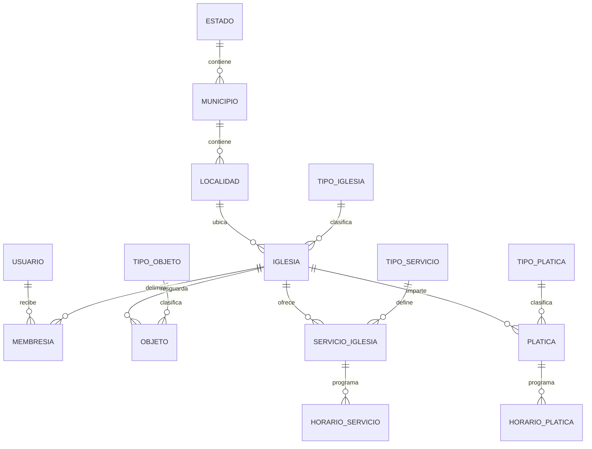
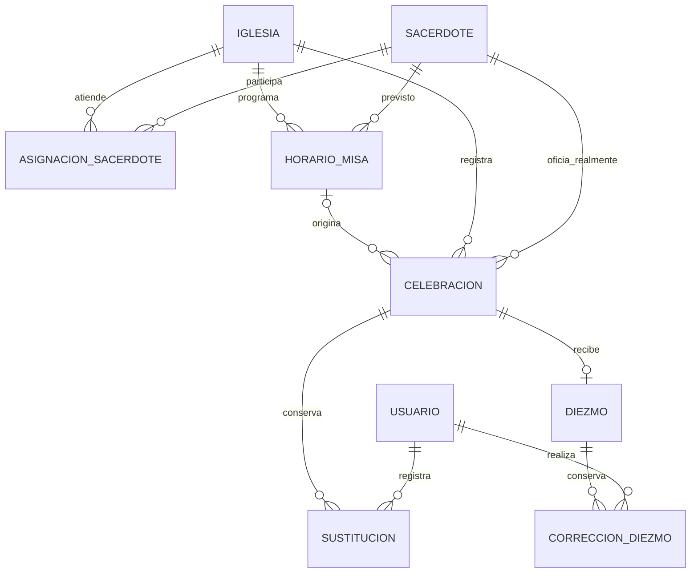
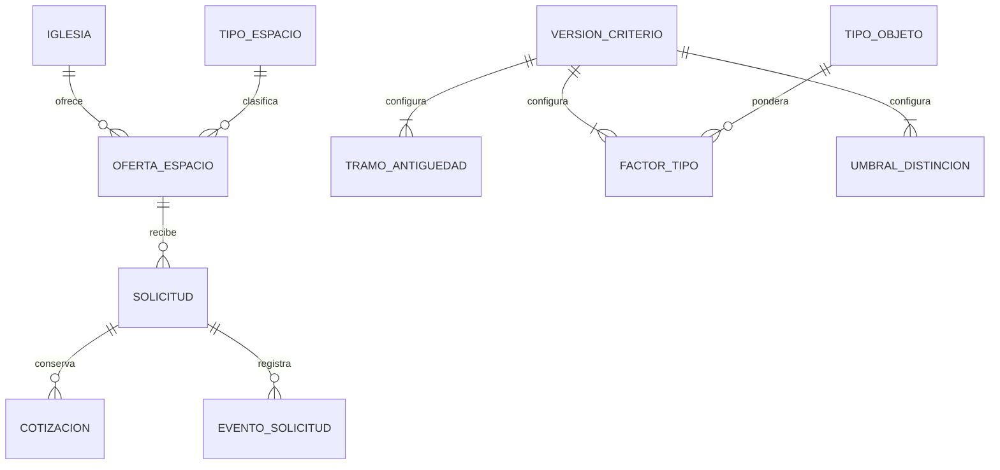

Esquema físico de servicios/pláticas implementado en migración aditiva 202611020002_servicios; [ADR007](adr/007.md) y [alcance](incremento-servicios.md). Número de sesiones informativo, sin vínculo obligatorio a servicio. El modelo preliminar siguiente es antecedente, no afirmación de ausencia actual de migraciones.

> Vista histórica conservada de revisión 01/02. Para estado vigente consultar decisiones-pc-revision03.md, consultas-docente-revision03.md, referencia-iglesias-revision03.md y trazabilidad-revision03.md. Las afirmaciones anteriores de ausencia total de producto/23 preguntas docentes no describen revisión 03.

# Modelo lógico preliminar de datos

Versión 0.1 para revisión. Fuente: RF-01 a RF-31, RN-01 a RN-22 y P063–P093. No hay migraciones ejecutadas ni esquema físico aprobado. Los nombres, UUID, claves y separación en tablas son decisiones técnicas propuestas. Las cardinalidades de diócesis, permisos acumulables y preparación/servicios están pendientes; no se dibujan como hechos confirmados.

## Geografía y ámbito

Municipio se identifica por `(estado_clave, municipio_clave)` y localidad por `(estado_clave, municipio_clave, localidad_clave)`. Las claves INEGI son texto, conservan ceros y procedencia de la carga; no se inventan longitudes sin revisar PC-01. Iglesia referencia esa clave compuesta. Se evita almacenar estado o municipio contradictorios. Una iglesia sin localidad conocida queda pendiente PC-02; el modelo final no usará una localidad ficticia para ocultarlo.

## Agenda, hechos y dinero

La opcionalidad de `horario_id` en celebración es una alternativa para PC-12, no autorización para registrar misas no programadas. Un sacerdote conserva una identidad compartida; la asociación con iglesias no duplica a la persona. No se agrega cuenta propia al sacerdote. La autoridad para editar esa identidad requiere PC-10.

## Solicitudes y configuración

La relación 0..N de cotizaciones preserva la posibilidad de versiones sin obligar a permitir recotizar. El servicio aplicará un máximo de una cotización vigente por solicitud; nuevas emisiones y reemplazos quedan bloqueados hasta PC-17/18. No hay entidad de cripta física, pago, contrato ni reserva: DES-04 está fuera del alcance base.

## Diccionario y restricciones previstas

Todos los IDs de negocio nuevos son UUID propuestos. `created_at`, instantes de auditoría y fechas límite usan instantes con zona en PostgreSQL; la API usa ISO 8601. Cada tabla dependiente de iglesia lleva `iglesia_id` y una clave candidata `(iglesia_id,id)`. Las FK de hijos incluyen el ámbito cuando corresponde. Nulabilidad, longitudes máximas de texto y campos de negocio obligatorios se cerrarán con PC-02/14; las columnas indicadas no equivalen a un DTO aprobado.

| Entidad | Atributos principales y claves | Restricciones o pendientes |
| --- | --- | --- |
| Estado, Municipio, Localidad | Claves oficiales, nombre; claves compuestas descritas | FK jerárquicas; carga INEGI versionada y fuente/hash, PC-01 |
| TipoIglesia | id, nombre | Seis categorías iniciales de RN-01; extensión PC-22 |
| Iglesia | id, localidad FK, tipo FK, nombre, dirección, capacidad, año_construcción, contacto, latitud, longitud, zona_iana, cerrada_desde | Sin DELETE de historial; cierre/reapertura y acceso directo PC-04; coordenadas opcionales; obligatoriedad PC-02 |
| Usuario | id, identificador_login, password_hash, activo, rol_coordinacion | Login único; sin contraseña en claro; bootstrap PC-19 |
| Membresia | usuario_id, iglesia_id, rol local | FK, unique de terna; estructura soporta varios roles/iglesias pero servicio no los habilita hasta PC-19 |
| TipoObjeto | id, nombre | Catálogo separado del factor versionado; extensión PC-22 |
| Objeto | id, iglesia_id, tipo_id, descripción, año_exacto, siglo, material, conservación, ubicación_interna, catalogado_inah, condición_vigencia | Guardar procedencia exacta o siglo; año estimado derivado. No contar préstamo/pérdida/baja; retorno y publicación PC-06; desconocido/futuro y conjuntos PC-05 |
| VersionCriterio | id, versión única, bonus_inah decimal, estado_borrador, inicio_vigencia propuesto, autor | Configuración validada completa; política de activación/histórico PC-08 |
| TramoAntiguedad | criterio_id, edad_desde, edad_hasta nullable, puntos decimal | Tramos sin huecos ni solapamientos; datos iniciales RN-06 |
| FactorTipo | criterio_id, tipo_objeto_id, factor decimal | Unique del par; incluye categoría otras; factores RN-07 |
| UmbralDistincion | criterio_id, mínimo decimal, etiqueta | Mínimos ordenados y únicos; sin distinción bajo 8; RN-09 |
| ServicioIglesia | id, iglesia_id, tipo_id, modalidad_aportacion, importe decimal nullable, moneda pendiente, requisitos, duración, requiere_cita | FIJO/GRATUITO/DONATIVO son nombres propuestos; no representar donativo como precio obligatorio |
| HorarioServicio | id, iglesia_id, servicio_id, día_semana, hora_local, duración | FK compuesta; recurrencia semanal como propuesta, excepciones por aclarar |
| Platica | id, iglesia_id, tipo_id, sesiones, importe decimal, moneda, cupo, lugar, impartidor | Informar cupo no implica inscripciones; relación a servicio PC-09 |
| HorarioPlatica | id, iglesia_id, platica_id, día_semana, hora_local | Separar múltiples días/horas; sin inventar reservas |
| Sacerdote | id, nombre y datos identificativos por acordar | Identidad nacional compartida, PC-10; no cuenta implícita |
| AsignacionSacerdote | iglesia_id, sacerdote_id, función e intervalo propuestos | Unique del par si no hay historial; elección de historial PC-10 |
| HorarioMisa | id, iglesia_id, sacerdote_previsto_id, día_semana, hora_local, tipo, idioma, duración_minutos, vigencia_desde/hasta propuestas | Duración por defecto 60; guardar zona IANA en iglesia; PC-11 para vigencia, excepciones y extremos |
| Celebracion | id, iglesia_id, horario_id nullable, fecha_local, hora_local, zona_snapshot, inicio_instante, duración, sacerdote_previsto_snapshot, sacerdote_real_id | Hecho ocurrido, no estado de una programación; FK compuesta de horario; registrar programadas futuras en otra estructura si luego se aprueba DES-02 |
| Sustitucion | id, iglesia_id, celebracion_id, sacerdote_anterior_id, sacerdote_real_id, actor_id, motivo, instante | Cambio auditable en transacción; ediciones históricas PC-12 |
| Diezmo | id, iglesia_id, celebracion_id, importe NUMERIC(p,2), moneda, versión | UNIQUE(celebracion_id); FK compuesta; precisión máxima p y moneda PC-13; no guardar float |
| CorreccionDiezmo | id, iglesia_id, diezmo_id, importe_anterior, importe_nuevo, actor_id, instante, versión | Append-only; update y auditoría atómicos; concurrentes con control de versión |
| TipoEspacio, OfertaEspacio | tipo(id,nombre); oferta(id,iglesia_id,tipo_id) | Unique(iglesia_id,tipo_id); oferta pública sin columnas de precio |
| Solicitud | id, iglesia_id, oferta_id, folio único, clave_hash, contacto privado por definir, estado_propuesto, versión | FK compuesta a oferta; clave de alta solo una vez; privacidad PC-14/15/19 |
| Cotizacion | id, iglesia_id, solicitud_id, importe decimal, moneda, condiciones, emitida_at, comunicada_at, vence_at, estado_propuesto | FK compuesta; 15 días según política por confirmar PC-17; ni importe ni contacto públicos |
| EventoSolicitud | id, iglesia_id, solicitud_id, cotizacion_id opcional, evento, actor_usuario_id nullable, tipo_actor, instante, versión | Actor solicitante sin usuario; guarda metadatos sin copiar la clave; historial atómico |

 No se añade un multiplicador por conservación ni una cantidad que duplique automáticamente los candelabros.

## Integridad que no puede quedar solo en la interfaz

- Toda consulta privada parte del ámbito autorizado del usuario; los UUID suministrados no conceden permisos. FK `(iglesia_id,celebracion_id)` impide vincular un diezmo A a una celebración B. La capa de aplicación verifica además rol, operación y ámbito.
- Unicidad de diezmo en BD, más transacción, no un `SELECT` seguido de `INSERT` sin restricción. Corrección y auditoría se confirman juntas con versión esperada; el conflicto no pierde la cantidad anterior.
- La asignación de sacerdote necesita coordinación global de sus intervalos, incluso al sustituirlo o editar duración. Una validación limitada al templo actual falla RF-18. Prever bloqueo por sacerdote/intervalo en transacción y revisar conflictos después de obtenerlo. No prometer exclusión de recurrencias con una restricción sobre horas semanales sin fechas y zonas.
- Las recurrencias son hora civil + zona IANA, día y vigencia; los hechos conservan el instante y la zona histórica. No usar un desplazamiento UTC fijo para todo México. La comprobación futura debe materializar intervalos sobre las vigencias acordadas y transiciones horarias, no validar solamente «las próximas cuatro semanas». PC-11 bloquea fijar ese algoritmo como definitivo.
- Para solicitudes, bloquear o comparar versión antes de aceptar/rechazar/cancelar, recalcular vencimiento con el mismo reloj y política, y grabar estado y evento en una transacción. Un proceso periódico puede actualizar vencimientos, pero no es la única guarda.
- Para el índice, usar decimal/racional exacto y criterios recibidos por la función pura. `año_estimado=(siglo-1)*100+50`. Guardar el año fuente y el siglo, no solo una edad que envejece. La respuesta incluirá criterio y referencia temporal usados; no se fija el año 2026 en producción.

## Bloqueos antes del modelo físico

PC-01/02/22: carga, tipos y nulabilidad; PC-05/06/08: fechas de objetos y criterios; PC-09: preparación; PC-10/11/12: identidad y agenda; PC-13: moneda/precisión/cortes; PC-14/17/18/19: contacto, estados y permisos. Diócesis queda en el glosario hasta PC-10. No ejecutar DDL ni imponer cardinalidad iglesia–diócesis con una suposición.

## Revisión 02: recorrido de versiones y proyecciones (1 de noviembre de 2026)

Sin cambiar el carácter lógico ni aprobar DDL, se explicita version como entero positivo de concurrencia en cada recurso mutable expuesto: Usuario, ítem de catálogo, Iglesia, Objeto, Servicio, Platica, Sacerdote, HorarioMisa, Celebracion, Oferta, Criterio, Diezmo y Solicitud. La futura persistencia debe comparar la versión leída, mutar/incrementar y auditar atómicamente; una versión obsoleta devuelve 409 sin efectos. El contrato no prueba esa transacción.

En VersionCriterio, numeroVersionConfiguracion identifica la revisión de parámetros patrimoniales; version es un contador independiente para ediciones concurrentes. La activación compara version de Criterio. Cotizar modifica Solicitud y recibe su version. La frontera concreta entre identidad compartida y asignación sacerdotal requiere PC-10: el contador del recurso expuesto no autoriza editar identidades ajenas ni resuelve aún el agregado físico.

La proyección pública HorarioMisa incorpora sacerdotePrevisto={id,nombre}; si además devuelve sacerdotePrevistoId, el servicio deberá comprobar igualdad. La proyección Iglesia exige procedencia de cálculo conjunta (indice, distincion, criterioId y referenciaTemporal); no almacena necesariamente campos derivados ni fija 2026. No se cambia la fórmula o el ejemplo 35.5.

[Contrato y validaciones pendientes](contrato-revision02.md). Este añadido corrige coherencia de diseño; las migraciones, concurrencia real y pruebas de persistencia siguen pendientes de H01/H02.
